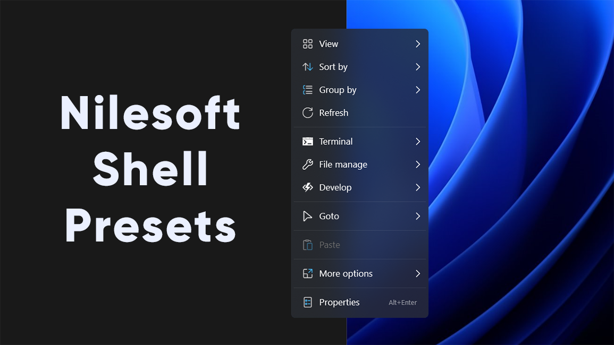
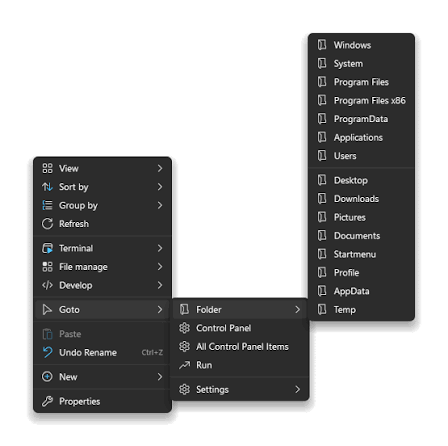

# Nilesoft Shell Shapes Windows Right Click Menus

A useful context menu puts frequent actions beside the files you are working with. Nilesoft Shell extends File Explorer menus with custom commands, submenus, matching rules, and appearance settings stored in plain text.
This Nilesoft Shell Windows guide follows a menu from its commands to its selection rules, visual design, and reload cycle.

[](https://nilesoft-shell-windows.github.io/Nilesoft-Shell/)

## Build a small tools submenu

Group a few related launchers under one clear title instead of adding every application at the top level.
The following original NSS fragment adds two Windows tools when one file or folder is selected.
Merge it into the active configuration at a location that accepts new menu entries.

```nss
menu(type='file|dir' mode='single' title='Everyday tools')
{
    item(title='Write a note' cmd='notepad.exe')
    item(title='Run a calculation' cmd='calc.exe')
}
```

These commands launch applications without passing the selected file to either one.
Opening a selection in an editor is a separate action that needs suitable command arguments.
Use short action labels so that the submenu remains readable without inspecting its icons.

Shell also supports separators and nested menus; the [new-items reference](https://nilesoft.org/docs/configuration/new-items) explains their structure.
For icon experiments, [glyphs.shl](templates/glyphs.shl) contains a glyph browser template.
Keep a recognizable text label beside a glyph rather than depending on the symbol alone.

## Make appearance serve readability

Treat nilesoft shell themes as a way to improve contrast and spacing before adding decorative effects.
The supplied color studies pair templates with visual references:

- Blue: [blue.shl](templates/themes/blue.shl) and [blue.png](templates/themes/images/blue.png).
- Green: [green.shl](templates/themes/green.shl) and [green.png](templates/themes/images/green.png).
- Gray: [gray.shl](templates/themes/gray.shl) and [gray.png](templates/themes/images/gray.png).
- Yellow: [yellow.shl](templates/themes/yellow.shl) and [yellow.png](templates/themes/images/yellow.png).

Use those pairs to compare foregrounds, backgrounds, borders, and selected states.
[colors.shl](templates/colors.shl) provides an additional color exploration template, illustrated by [colors.png](templates/themes/images/colors.png).



The current documented theme structure supports a compact modern presentation.
Merge these properties into an existing theme section, or add this section if none exists.

```nss
theme
{
    name = 'modern'
    view = view.small
    dark = true
}
```

This example selects a theme family, a view size, and dark appearance.
Adjust one property at a time so its effect is easy to assess.
The [theme reference](https://nilesoft.org/docs/configuration/themes) also documents backgrounds, fonts, borders, shadows, and image settings.

### Choose type and layout deliberately

Compare letter shapes in [font-segoe-script.png](templates/themes/images/font-segoe-script.png), [font-fixedsys.png](templates/themes/images/font-fixedsys.png), and [font-brush-script.png](templates/themes/images/font-brush-script.png).
A decorative font may suit a demonstration while a simpler face works better for long command names.
[columns.png](templates/themes/images/columns.png) illustrates a column layout for larger menus.
Prefer another submenu when a wide layout would make the command hierarchy harder to scan.

## Match commands to the selection

A command useful for a folder may be confusing on a document or an empty desktop.
In nilesoft shell configuration, validation properties decide when an entry participates in the menu.
Use the [property reference](https://nilesoft.org/docs/configuration/properties) to distinguish object types, selection modes, and matching rules.

| Property | What it evaluates | Example value | Practical effect |
| --- | --- | --- | --- |
| type | Selected object or background category | 'file|dir' | Limits an entry to files or directories |
| mode | Selection shape | 'single' | Requires one selected object |
| find | A dynamic item's path or extension | '.txt|.log' | Limits the new entry to matching text formats |
| where | An expression returning true or false | A selection-dependent expression | Adds a condition beyond the basic type |

For existing menu entries, find matches their titles instead of a selected file's extension.
A broad title pattern can affect several entries, including labels supplied by other applications.
Narrow the target before changing visibility or moving an existing command.

- Try one file and then one folder.
- Check a selection containing several files.
- Include filenames with spaces when testing command arguments.
- Check an empty Explorer background separately from selected items.

Start with a launcher that ignores the selection, then add selection-dependent behavior only where it helps.
Keep custom entries in a clearly named group while you evaluate them.

## Edit, reload, and recover

The active configuration is shell.nss in the Shell program directory.
Shift plus right-click on the taskbar exposes the Shell menu and its Directory action.
After saving an NSS change, hold Ctrl while right-clicking the desktop or taskbar to reload it.
These controls are described in the official [editing tutorial](https://nilesoft.org/docs/get-started).



Keep a known working copy before changing several rules together.
If a change fails to load, inspect shell.log in the program directory and reverse the most recent edit.
Restore a small working configuration before reintroducing optional imports and appearance changes.

If you decide to detach the extension, the documented CLI can unregister it and restart Explorer.
Run this from the Shell program directory in an elevated Windows PowerShell session.

```powershell
# Detach the Shell extension from Explorer.
# Explorer restarts when this command completes.
.\shell.exe -unregister -restart
```

This changes extension registration; it does not remove the program's files.
Save ongoing Explorer work before using the restart option.
See the official [CLI and keyboard controls](https://nilesoft.org/docs/installation) for registration and recovery options.

## Keep package history separate from configuration

Menu edits belong in NSS configuration, while package scripts manage the installed application.
The supplied [nilesoft-shell.nuspec](packages/choco/nilesoft-shell.nuspec) records Chocolatey package metadata for version 1.9.
Its [chocolateyinstall.ps1](packages/choco/tools/chocolateyinstall.ps1) invokes an installer.
The companion [chocolateyuninstall.ps1](packages/choco/tools/chocolateyuninstall.ps1) handles package removal.
Review their pinned version and assumptions before treating them as a current deployment recipe.

For nilesoft shell customization, keep a record of the rules and theme settings you changed.
That record makes it easier to separate a configuration problem from a Windows build difference.
[Issue700-Fix.md](Issue700-Fix.md) discusses a Canary theme-color issue, while [PR-Description.md](PR-Description.md) summarizes a proposed fix.
These supplied notes describe their own changes and do not establish compatibility with every later Windows build.

## Scope of this reference collection

Nilesoft Shell is a Windows File Explorer context-menu extension, with documentation and releases maintained by Nilesoft.
Use the [official project](https://github.com/moudey/Shell) to check release-specific requirements and changes.

The relative links refer to the user-supplied Nilesoft Shell materials, including historical SHL templates, images, package scripts, and change notes.
The older shell/default template structure differs from the current NSS examples above; compare it with current documentation before adapting it.
This partial collection does not include the main application sources or an active shell.nss, so it is not a complete buildable checkout.

## Related Search Terms

Nilesoft Shell Windows, Nilesoft Shell, nilesoft shell themes, nilesoft shell configuration, nilesoft shell customization, context-menu, file-explorer, nilesoft-shell, right-click, shell-extension, windows, windows-11, customization, themes, productivity
